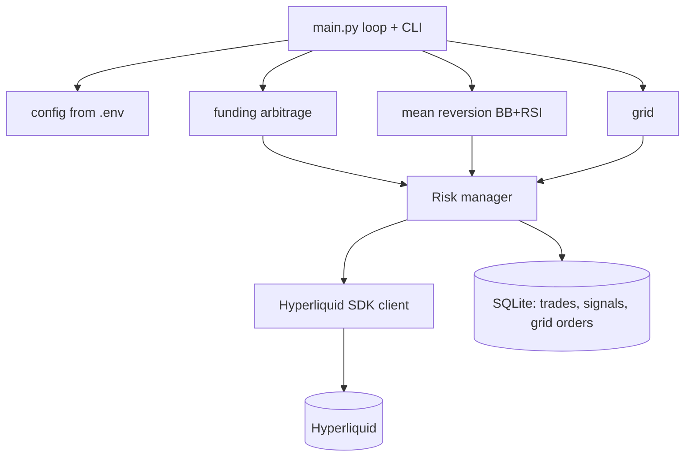

# Hyperliquid trading bot

Algorithmic trading bot for Hyperliquid DEX running three strategies side by side: funding rate arbitrage, Bollinger+RSI mean reversion, and grid trading.

## The three strategies

**Funding rate arbitrage.** Shorts overfunded perps, hedges long via spot or cross-exchange. Collects the funding spread delta-neutral. This is the boring-but-reliable one: the return comes from the funding payments, not from price direction.

**Mean reversion.** Bollinger Bands + RSI on 1h candles. Enters when price is outside the bands and RSI confirms the oversold/overbought condition, targets return to the SMA.

**Grid trading.** A ladder of limit orders around the current price. Profits from ranging markets by capturing the spread between grid levels. Shuts up when the market trends.

All three run off a shared risk manager: per-trade position cap, total exposure cap, daily stop loss, and low leverage (1x arb, 2x MR, 1x grid).

## Architecture

## Hyperliquid-specific lessons

Things I learned the hard way, worth writing down:

- No native market orders. Everything is IOC limit orders. Your "market sell" is a limit at best bid, and in thin books that matters.
- 200ms latency baseline, 500ms+ during volatility. This is not an HFT venue, so the strategies above are chosen for latency tolerance.
- Rate limits are address-based and start around 10K requests. The bot batches reads and only writes on state change.
- Perps are USDC/USDT quanto. There is a basis risk between the perp and the underlying that shows up in the funding arb PnL.
- Testnet first. Always. Hyperliquid testnet behaves differently enough in thin markets that mainnet-first is how you donate money.

## Stack

Python, official Hyperliquid SDK, SQLite for state, `.env` config. Single process, no external dependencies beyond the SDK, designed to run on a small VPS next to the exchange's infra.

---

*Showcase repo: architecture and notes only. Strategy implementation stays private.*
